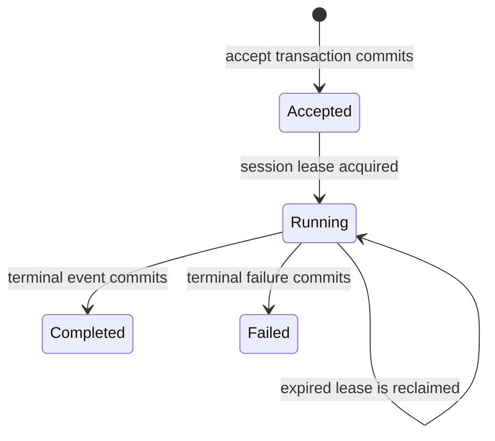

# runtime

Durable execution for the provider-neutral `agent` loop. The runtime accepts
a surface prompt before work starts. It maps conversations to sessions and
sub-conversations to lanes, with one fenced writer per session. PostgreSQL
and file-backed SQLite provide durable storage.

## Setup

```rust
use std::time::Duration;
use agent::Registry;
use runtime::{Address, Config, PostgresStore, Prompt, Runtime};

let store = PostgresStore::connect(&database_url).await?;
let config = Config::new("deployment-instance-7", Duration::from_secs(30))?;
let runtime = Runtime::with_config(store, config);

let address = Address::new("app", "conversation-42", "thread-9")?;
let prompt = Prompt::new(address, "event-id", "Be useful.", "Hello")?;
runtime.accept(&prompt).await?;

while runtime.run_next(&model, &Registry::default()).await?.is_some() {}
# Ok::<(), Box<dyn std::error::Error>>(())
```

`PostgresStore::connect` creates a pool, requires `synchronous_commit`, `fsync`,
and `full_page_writes` to be on, and applies the embedded schema baseline
(`0001_runtime.sql`, one transaction). The database role therefore needs
connect, schema DDL, and table DML privileges. Use a stable, unique worker
identity per live process. `Runtime::new` generates a process-local identity
and uses a 30-second lease; explicit `Config` is preferred in a multi-replica
deployment.

The schema ships as one baseline. Startup records the applied version. SQLx
rejects databases with migration records outside the binary's embedded
manifest. Future schema changes extend that manifest forward: databases can
move to a newer binary, but cannot return to an older one after their recorded
version advances.

## Backend contract

`Runtime<S>` accepts any store implementation that satisfies its bounds.
`DurableStore::connect` selects PostgreSQL or SQLite from the URL and implements
every store trait used by the application. Embedders can also construct
`SqliteStore` directly. No existing trait method became mandatory.

Both backends commit admission, fencing, journal writes, settlement, schedule
release, and subagent notifications atomically at their defined boundaries.
Replay codecs, attachment validation, recurrence decoding, and operation-state
interpretation are shared. PostgreSQL uses row and advisory locks; SQLite uses
immediate write transactions. SQLite applies its schema under an immediate
write transaction, holding the write lock during inspection and application.

SQLite startup requires file storage, WAL, full synchronous commits, and foreign
keys. All processes sharing the file must be on one host. PostgreSQL remains
appropriate for workers on separate hosts. See [operations](../../docs/operations.md#sqlite)
for storage, backup, and deployment rules. Switching a URL does not migrate data.

`backend_contracts` runs the same application behavior on both backends. SQLite
cases run in `cargo xtask gate`; PostgreSQL cases run in `cargo xtask postgres-test`. SQLite
also tests cross-pool ownership, concurrent migrations, unreadable records, and
recovery after an abrupt child-process exit.

Custom stores restoring an `operation-v2` execution profile must supply the
number of durable `Appended` assistant events in the current operation through
`Thread::with_tool_sequence`, including events hidden by compaction. Set zero
for an unstarted operation. SQLite, PostgreSQL, and the memory store restore
this count from their journals. Restoring a new-profile thread without it
returns `corrupt_record` before tool dispatch instead of inventing an effect key.
No new store method or journal event shape is required.

## Identity and acceptance

An `Address` maps `(surface, conversation)` to one session and the lane name to
one lane in that session. The lane's system prompt is immutable. `(lane,
request_id)` is the idempotency boundary: replaying identical input returns the
original operation, while reusing the ID with changed input is rejected.

`accept` queues the operation and commits the session, lane, original surface
text, model-visible prompt, and optional `DeliveryTarget` in one transaction.
Admission layers may add skills or memories to the model-visible text.
Retries compare the separately stored original text. Changes to enrichment
after a crash cannot create another accepted operation or hide changed caller
input.
A surface may acknowledge receipt only after acceptance returns.

`admit_with_tools` is the surface-facing policy boundary. On an idle lane it
accepts an operation; on an active lane it stores the prompt as steering for
that operation. Both paths deduplicate by `(lane, request_id)`. The supplied
system prompt creates a new lane. Existing lanes keep their stored prompt,
even after deployment changes to surface configuration. Low-level `accept` remains strict and rejects a
configuration mismatch.

An idle lane adopts the execution profile supplied with its next operation,
so deployment-level turn-budget changes do not invalidate existing lanes. An
active operation and steering accepted into it keep that operation's existing
profile; the new profile takes effect after the lane becomes idle.



## Leases, recovery, and visibility

PostgreSQL claims lock the operation, lane, and session using `FOR UPDATE ... SKIP LOCKED`.
SQLite claims hold an immediate transaction while selecting work and advancing
the session fence.
The session lease enforces one writer across lanes and replicas. Every claim
increments a fencing token; event writes and heartbeats require the current
owner, token, unexpired lease, and running state. Terminal state, outcome, and
lease release commit atomically.

The runtime records model and tool-loop events at durable boundaries:

- A crash during a model request may cause that request to be sent again after
  lease expiry. No response becomes conversation history until its event
  commits.
- A durable tool call receives
  `operation/{operation}/step/{step}/call/{provider-call-id}`. A tool must
  atomically store this key with its side effect and return the prior result on
  retry. Without deduplication, retries can repeat the effect.
  The operation-wide response sequence determines `step`. It survives
  steering, compaction, and process recovery.
- A persistence error stops the driver. Another replica may resume only after
  the lease expires or the terminal transaction releases it.

`ModelDelta` records provisional presentation progress. It never rebuilds the
agent thread. Only the settled assistant `Appended` event becomes provider
context, and only `RunFinished` carries the authoritative outcome.

Accepted work is durable and has one committed outcome. Provider requests
can still incur duplicate charges. External tools must handle their own
idempotency.

## Surface delivery

A delivery worker claims work by adapter under its own fenced lease. Unread
journal events are always claimable. After the adapter's presence interval,
accepted work and running operations with caught-up cursors are also claimable.
This lets a surface show queued work and refresh a live turn's indicator
without waiting for another journal event.

Each checkpoint advances the cursor for claimed events, records `presented_at`,
and may save the surface's external message ID. A crash resumes from the last
committed cursor. Once another replica takes the lease, the old worker cannot
checkpoint. A worker can renew its lease during an external presentation. A
failed renewal returns `lease_lost` and leaves the batch pending. New journal
events fence empty presence-only leases, so indicator refreshes cannot delay
durable progress.

Presence is scoped to a lane and adapter, not to every queued operation. The
oldest accepted or running operation represents that live lane. A later
operation in the same lane and adapter remains ineligible until its predecessor
has no pending delivery, so a caught-up terminal checkpoint from an older
binary cannot strand the lane. Parallel delivery workers cannot post
committed replies out of conversation order. Other lanes and adapters remain
independently claimable.
This keeps presence work bounded when several prompts wait behind the same
session writer.
A terminal checkpoint leaves a settled delivery tombstone. Idempotent
acceptance cannot revive that delivered operation. Claim polling uses a
partial index that excludes tombstones, so idle work depends on claimable
deliveries instead of accumulated history. Polling is proportional
to the unsettled working set across adapters; a synthetic 200,000-row
adapter-skew backlog measured 135 ms. Deployments that expect a working set of
that size need adapter partitioning beyond this schema. If a failed index
build leaves an index invalid, the next startup serializes its repair before
retrying migrations, without blocking operation writes.

Accepting new steering clears `presented_at` and fences any presentation lease
in the same transaction, making the running operation immediately claimable
until delivery successfully presents and checkpoints it again. Checkpointing a
terminal event hands presence to the next accepted or running operation in the
same lane and adapter, fencing that handoff if it is already in flight. Other
lanes and adapters are unchanged.

`Store::save_media` stores each returned image and file before recording
`ToolFinished`. It stores `Media` by reference (`media::reference` or
`file_reference`) under the operation's root session, including for subagents.
Files stay in media storage and never enter the thread. Saving the same media
again refreshes its age without duplicating it. A file row keeps its name; the reference's prefix, not the media type,
says what a row holds, so a file whose media type is `image/png` reads back
as a file. A row this build cannot interpret returns `corrupt_record`.
`DeliveryStore::media(operation, reference)` reads one back for a reply from
any lane of that root, after compaction or a restart. It is a read: it takes
no lease. PostgreSQL keeps rows in `tool_media` for 7 days from their last
store and prunes older rows on every write; a row it cannot interpret is
`corrupt_record`. The memory store keeps media for the life of the process.

## Steering

The built-in stores expose a fenced, non-consuming `Store::has_steering`
probe. During ordinary inference the runtime polls it every 100 ms. On pending
input it drops the old generation future, then converts one queued prompt to
ordinary durable user events and starts a new request. A probe never consumes
input, so cancellation cannot commit a correction without applying it.
Partial output and unfinished reasoning never enter provider history. Completed
reasoning stays unchanged, including across tool results, steering, and recovery.

Before each unstarted tool call, the runtime checks for steering again. An
already running tool finishes; remaining calls receive structured
`tool_call_superseded` errors without executing. The full result batch commits
before the steering user event, preserving provider call/result pairing.
A crash between those commits recovers the closed batch and pending correction.
Superseded means not started in the current attempt. After a crash, an earlier
attempt may already have produced an external effect without storing its full
result; the error explicitly requires reconciliation before retrying that action.
Steering cannot undo an effect that has started. Tools must still honor
their durable idempotency keys. A provider may continue work and billing after
generation is cancelled.

Custom stores retain boundary-only steering through the default probe and can
opt into interruption by implementing its cancellation-safe read contract.
`None` means the probe is unsupported; `Some(false)` avoids an empty consuming
transaction, and `Some(true)` permits interruption.
FIFO admission and one-prompt-at-a-time consumption remain unchanged.
The terminal settlement transaction locks the operation and lane,
then either appends steering and continues the loop or records `RunFinished`,
marks the operation terminal, and releases its lease. A process crash leaves
unconsumed steering available to the replacement writer. New steering also
invalidates the active operation's surface presentation atomically; a duplicate
admission does not invalidate it again.
Each consumed steering prompt starts a fresh model-turn budget. Compacted
steps from the preceding turn do not consume that budget, including on replay.

`failure_boundaries` exercises lost model-commit acknowledgements, external
effects before tool-result persistence, partial tool batches, interrupted
streaming, failed heartbeats, steering-commit acknowledgement loss, and delivery
receipt recovery with stale-lease rejection. The SQLite campaign also holds a
real writer lock past the busy timeout. The same commit-boundary cases run on
PostgreSQL through `cargo xtask postgres-test`.

## Compaction

`Runtime::compact` appends a summary for a completed operation boundary. It
never deletes the event journal. Future context starts with
`Message::Summary` and then replays operations after that boundary. Empty,
backward, conflicting, cross-lane, non-terminal, and concurrently running
boundaries are rejected.

`Config::with_compaction` also enables automatic compaction. Before every model
request, the runtime estimates the serialized thread plus the claim's tool
definitions. At the configured token limit it asks the same model for a summary
without tools, records `Event::Compacted`, and continues from
`Message::Summary`. The journal remains append-only, steering is applied before
the next regular model request, and compaction does not reset the turn budget.

A summary request must fit the provider's context window. The history may
exceed that window if estimates undercount or old tool results lack size
bounds. The runtime tries progressively smaller requests after each
`context_window_exceeded` response:

1. The whole history, with its images when the replay bound
   allows them.
2. The whole history as text.
3. The newest half of its user turns, halving until one turn is left. A rung
   always starts on a user turn, because a provider rejects a request that
   opens on an assistant message or on tool results whose calls it cannot see.

Each request bounds tool results to `agent::MAX_TOOL_RESULT_BYTES`. The
summary omits turns excluded from the request that fits. If even one turn
exceeds the window, the operation fails with `context_window_exceeded`. The
next prompt starts a new turn and can fit without that history, so the failure
does not permanently block the lane. No records commit between these attempts.
After a crash, recovery tries the sequence again.

The estimate triggers compaction, but provider refusals also trigger it. If
a regular request returns `context_window_exceeded`, the runtime compacts and
retries from the summary. It never appends the refused response. A one-message
thread has nothing to omit, so that refusal ends the turn after one request.

A summary whose stream broke (`transport_error`, `request_timeout`,
`provider_unavailable`) gets up to three attempts with sub-second backoff.
These retries cover failures after the provider response stream opens.
Other failures, including `rate_limited`, are not retried here. The provider
handles throttling before the stream opens, honoring HTTP `retry-after` or
using 1 to 20 seconds of SDK backoff on Bedrock. Mid-stream throttling reaches
the runtime as a failed summary.

The attempt budget belongs to the run. Once a summary fails, queued steering
reuses that outcome without further provider calls.

A failed summary then ends the turn, never the worker. The operation settles
through the ordinary path: terminal, so no replica re-claims it, *unless
steering arrived while it ran*, in which case the steering is absorbed and the
run continues, exactly as for any other failed outcome. That loop is bounded by
the steering queue (one queued prompt per iteration), but not by the turn
budget, because a failed summary appends no assistant message. It costs no
further provider calls, because the failed outcome is reused.

A provider failure keeps the provider's own code (`rate_limited`,
`provider_unavailable`), identical to that failure during a regular turn, with
the stage named in the message so an operator can tell a throttled summary from
a throttled reply. A throttle during compaction is reported after one attempt,
not three. A nonterminal, empty, or tool-calling response reports
`compaction_failed` with the stop reason in its message. Neither is a
`runtime::Error`.

Summaries start with the lane's accepted reasoning effort. If a response hits
`MaxTokens`, the runtime makes one new request at `low` effort when the model
supports it. Reasoning and summary text share the output budget. The fallback
leaves more room for text; successful summaries permanently replace the prefix.

A summary the model cannot fit in `ANTHROPIC_MAX_TOKENS` even at `low` effort
is not recoverable by retrying: every turn on that lane will fail until the
output budget is raised. `Runtime::compact` would clear such a lane by hand,
but no surface in this workspace calls it, so there is no operator recovery
path today.
Operators running long threads should size `ANTHROPIC_MAX_TOKENS` for a summary
plus its thinking, not for a chat reply.

The provider-neutral estimator uses the greater of Unicode scalar count or
UTF-8 bytes divided by four. Its units are not
provider tokens, and the ratio is script-dependent: measured against a 4
bytes-per-token rule it runs 4.0x real tokens for ASCII and 1.25x for CJK, so
one configured limit gives ASCII roughly three times the headroom it gives CJK.
Set the limit from the provider's real context window and keep a safety
margin. Do not treat the estimate as an exact token count.

## Scheduled work

`ScheduleStore` persists follow-up prompts against their originating lane.
Relative timing is resolved once; retries with the same operation and
idempotency key return the original schedule. A schedule's owner is the
authenticated actor of the operation that created it. Listing and cancellation
reach the schedules created in the caller's lane and, when the caller is in a
conversation private to that principal, every schedule the same provider,
tenant, and actor owns; a shared conversation never lists one person's
schedules to everyone in it. Unauthenticated schedules have no owner and stay
lane scoped.

A `ScheduleRequest` with a `Destination` posts each run as a new conversation
root elsewhere instead of replying in the origin lane. The destination names a
surface session (`surface`, `conversation`), the surface's routing record for a
new root (`target`), and the principal the runs execute as (`identity`). The
store accepts one only from an authenticated operation that has a delivery
target and that no schedule released (a person's own surface message, never a
scheduled run or a subagent), posting as that same provider, tenant, and actor
into a conversation that is not private to them, whose session key is the
identity's `conversation_key()`; anything else fails with
`schedule_destination_forbidden`.
One owner may create `MAX_POSTS_PER_OWNER_PER_HOUR` (10) such schedules in a
trailing hour (`schedule_post_rate_exceeded`), counted under the owner's
advisory lock. Each release opens a new lane in the destination session, named
by the run's request ID and carrying the origin lane's system prompt, tool
definitions, and profile, with the destination identity. The surface posts the
root, then calls `DeliveryStore::bind_lane` under its delivery lease: the lane
takes the root's external ID and the operation's delivery target becomes the
reply route, so a retry after the bind is an ordinary thread delivery and
replies to the root join the run's lane with its history. `bind_lane` returns
`false` when another lane already holds that ID. Every released operation
records `schedule_id`. Anyone whose operation is in the destination
conversation (same provider, tenant, and conversation) can list and cancel the
schedule. `DeliveryBatch::accepted_unix_ms` bounds a surface's search for a
root it posted before a crash, and `DeliveryStore::source_text` returns what a
person wrote for an operation, before any context was added.

An ordinary claim transaction first promotes at most one due schedule into an
accepted operation with request ID `schedule/<id>`, copies its delivery target
and execution identity, and marks it released. PostgreSQL uses database time
and `FOR UPDATE SKIP LOCKED`, so replicas cannot promote the same schedule
twice. No scheduler daemon or in-process timer owns correctness.

A standing schedule (`ScheduleTime::Repeat`) holds a `Recurrence`: elapsed
minutes, or a local time in an IANA zone every N days, every N weeks on ISO
weekdays, or every N months on a day of the month (clamped to a shorter
month's last day) or on the 1st to 4th or last weekday. `RepeatSpec` is its
field form, the RFC 5545 subset FREQ, INTERVAL, BYDAY (with ordinal), and
BYMONTHDAY; the runtime validates it on creation and again when it reads a
stored rule, and rejects an unreadable one as `corrupt_record`. Intervals and
every-N rules count from the row's `created_at`: an interval runs whole steps
after it, and an every-N rule runs the periods of its first occurrence after
it. New rows store the rule as JSON under kind `recur`; rows of kind `repeat`
keep their `repeat_*` columns and decode to the same type. A standing row stays
pending: each release promotes an operation with
request ID `schedule/<id>/<run_at_unix_ms>` and advances `run_at_unix_ms` to
the first occurrence strictly after now, so downtime yields one catch-up run
and DST changes keep the wall-clock time (a time inside a spring-forward gap
runs just after it). A row whose previous run is still
accepted or running is not due, so runs never overlap. A schedule that replies
in its origin lane is not due while that lane is unfollowed
(`LaneStore::unfollow_lane`); `Scheduled::paused` reports it, and following
the lane again resumes it with at most one catch-up run. `MAX_REPEAT_PER_LANE`
(20) standing rows per lane are admitted under the lane lock, and
`MAX_REPEAT_PER_OWNER` (50) per owner across lanes under a transaction
advisory lock on the owner, taken in its own statement before the count. The finish
transaction settles the row's `consecutive_failures`: a success resets it and
the `REPEAT_FAILURE_CANCEL_AFTER`th (14) consecutive failure cancels the row.
From `REPEAT_FAILURE_NUDGE_AFTER` (3) the failed run's `DeliveryBatch` carries
`notice`, runtime-owned text a surface appends to its failure reply.

## Tool catalog

A claim offers its registry's tools. Before the first model request, the
runtime refreshes every `agent::ToolSource` and fixes the result for that
claim. All requests in the loop then share one cached prefix. The next
operation sees added or removed tools. A resumed operation also refreshes the
catalog and offers the schemas that the running code accepts.

A subagent's grant is the names of the tools it was spawned with, read from its
`subagent_runs` request. Its operations offer those names at their current
schemas. A tool added after the spawn is not granted, and a child spawned with
no tools can call none.

A catalog change alters the request prefix, so each lane misses the provider
cache once on its first request after the change.

## Durable subagents

`SubagentStore` creates each child as an isolated session linked to its parent
operation and root session. The spawn key is idempotent, the resolved execution
profile is stored with the child lane, the tool names it was spawned with
form its grant (see Tool catalog), and
`run_operation` claims only the named child. Follow-ups append operations to
that same lane. Retrying a follow-up returns its original operation and keeps
the latest child operation unchanged. Stop changes accepted or running work to
`agent_cancelled` and advances the session fence before returning.

Background completion atomically creates one idempotent operation in the
parent lane. PostgreSQL serializes the per-tree active-child count by locking
the root session; the limit is 20 across all replicas.

## Stable failure codes

| Code | Meaning |
|---|---|
| `invalid_input` | An external identity is empty or a lease duration is zero or unrepresentable |
| `idempotency_conflict` | A request ID was reused with different input |
| `lane_configuration_conflict` | A low-level accept changed a lane's system prompt or execution profile |
| `durability_not_guaranteed` | A required database durability setting is off, or SQLite uses memory storage |
| `store_unavailable` | The database could not be reached or aborted the operation for a transient reason (connection, pool timeout, serialization conflict, deadlock, shutdown, resources); a retry can succeed |
| `store_failed` | The database refused the operation itself (for example a constraint or a NUL byte in text); a retry fails the same way |
| `session_busy` | Session deletion refused an active execution or delivery lease |
| `lease_lost` | The writer no longer owns the current unexpired fence |
| `corrupt_record` | Stored state cannot be interpreted safely |
| `invalid_compaction` | The summary or boundary is unsafe |
| `schedule_not_found` | Scheduled work is absent or not visible to the caller |
| `schedule_limit_exceeded` | The lane already holds the maximum standing schedules |
| `schedule_owner_limit_exceeded` | The owner already holds the maximum standing schedules across lanes |
| `schedule_destination_forbidden` | A schedule that posts elsewhere was not requested by a person's own surface message, as them, into a shared conversation |
| `schedule_post_rate_exceeded` | The owner already created the maximum posting schedules in the trailing hour |
| `invalid_delivery_checkpoint` | The cursor moves backward, beyond the journal, or under a stale delivery fence |
| `agent_concurrency_exceeded` | A root tree already has 20 active children |

`CODE_COMPACTION_FAILED` (`compaction_failed`) is an operation outcome code,
not an error code: it reaches the surface as a failed turn. So is
`context_window_exceeded` when even the smallest summary request did not fit.

Consumers branch on `Error::code()`, never on display text. Stored events carry
schema version 1; recovery rejects unknown or malformed versions as corruption.

## Testing

The normal workspace gate uses an in-memory implementation of the same `Store`
contract and never opens a PostgreSQL connection:

```sh
cargo xtask gate
```

Migration, transaction, compaction, and cross-pool fencing checks are opt-in.
The database is migrated and receives test rows, so point this only at a
dedicated disposable database:

```sh
BRAINSTONE_TEST_DATABASE_URL=postgres://... cargo xtask postgres-test
```

## Deliberate limits

- `run_next` claims and finishes at most one operation; `run_operation` targets
  one id but waits behind earlier nonterminal work in that lane. The host owns
  polling, shutdown, admission control, and surface acknowledgements.
- Tool batches run sequentially.
- Operators control retention. Automatic compaction keeps the full event
  journal and changes only provider context.
- Recurrence has no end date or run count, and no fifth-weekday rule (most
  months lack one). The operator's interval floor is enforced by the
  `Schedule` tool; `ScheduleStore` callers enforce their own.
- Cancelling stops future runs only. A run already in progress finishes: ending
  it from outside its lease would make the cancel path a second writer of that
  session's journal. A steering message reaches the run before its next model
  call, and whether it stops there is the model's decision.
- A standing schedule's identity is the acceptance-time snapshot. Nothing
  re-checks that the owner still exists; the failure streak is the only
  automatic stop. Delivery failures retry and never count toward the streak.
- `Store` is public for deterministic contract tests and alternate durable
  implementations. Implementations must define `admit_with_tools` explicitly:
  surface admission preserves an existing lane's system prompt while low-level
  `accept` stays configuration-strict. `PostgresStore` and `SqliteStore` carry the durability contract for their
  supported deployment profiles.

The append-only conversation tree follows
[Pi's session design](https://github.com/badlogic/pi-mono/blob/main/packages/coding-agent/src/core/session-manager.ts),
the replayable step machine follows the same principle as
[Rig's sans-I/O agent loop](https://docs.rs/rig/latest/rig/agent/run/index.html),
and claim/heartbeat/fencing boundaries were checked against
[Codex's durable runtime](https://github.com/openai/codex/tree/main/codex-rs).


## Operator inspection and authorization

`DurableStore::{operations,inspect,journal}` provide bounded operator reads.
Metadata omits conversation bodies; explicit journal access decodes stored event
versions and rejects unknown versions. No read changes lease ownership.

`Config::with_tool_policy` adds a gate at the shared execution boundary.
`ToolPolicy::new` accepts exact names or `*`; deny wins. `Store::authorize_tool`
has an additive default returning `ApprovalState::Unsupported`, so existing
custom stores compile unchanged and required authorization fails closed.
`DurableStore` persists exact `ApprovalRequest` bindings and immutable decisions;
`approval`, `pending_approvals` and `decide_approval` support operator review.
Actor names are attribution; database access is authority. Decisions expire
15 minutes after creation. Pending waits renew the lease and remain steerable.
Recovery requires the same request and current policy/executor binding.

Tool-result codes: `tool_policy_denied`, `tool_approval_denied`,
`tool_approval_expired`, and `tool_approval_unsupported` all mean this attempt
did not dispatch the tool. Earlier attempts may still need effect
reconciliation. Storage conflicts use `invalid_input`; malformed/unknown
approval records use `corrupt_record`; stale writers use `lease_lost`.
Native tools, remote servers and custom stores retain their existing trust
boundaries. See [tool approval configuration](../../docs/tools.md#constrain-an-operation).

### Deleting a durable session

`DurableStore::delete_session(&address)` permanently removes the root session
identified by the address's surface and conversation; the lane is ignored. It
returns `false` if the session is absent. All lanes and subagent descendants,
operations, journals, compactions, steering, approvals, interactions, schedules,
deliveries, and stored media owned by the session are removed in one transaction.
A later acceptance at that address creates a new session and may use a new
system prompt or execution profile.

Stop admission, execution, and delivery workers for that conversation before
calling it. Active execution or delivery leases in the session tree return
`session_busy`; addressing a subagent directly returns `invalid_input` with
field `root_session`. Storage failures roll back the deletion. The API does
not terminate external tool processes. Schedules owned by deleted sessions are
removed; schedule links into surviving conversations are detached while their
operations remain. Shared memories have independent ownership and are
retained. No database migration is required.

## Public operation values

`Operation` keeps public fields so custom `Store` implementations can construct
their results. Call `Operation::validate` after construction or mutation; it
returns `corrupt_record` unless accepted/running operations have no outcome,
completed operations have `Outcome::Completed`, and failed operations have
`Outcome::Failed`. Operation deserialization and database outcome decoding
enforce the same contract. Existing valid serialized records keep their shape.
Custom stores construct `OperationId`, `SessionId`, and `LaneId` with `new` or
`TryFrom<i64>`; each rejects nonpositive identifiers with `invalid_input` and
its corresponding `operation_id`, `session_id`, or `lane_id` field. Their
integer serialization stays unchanged, and deserialization applies the same
positive-identifier validation.

## Accepted tool contracts

The prompt's execution profile can carry an agent `ToolContract`. Its allowlist
restricts both advertised tools and dispatch. Approval requirements use the
existing durable approval flow, even without an operator `ToolPolicy`. The
approval digest binds the accepted contract, exact call, definition, identity,
and any current operator binding. Operator denial takes precedence.

| Code | Meaning |
| --- | --- |
| `tool_contract_denied` | The accepted contract excludes this call; it was not dispatched |
| `tool_contract_unavailable` | An explicitly named accepted capability is unavailable; no inference was made |

Completion requirements count only successful `Appended(ToolResults)` records
from the current operation. Built-in stores restore this evidence from the full
operation journal, including results replaced by compaction. Custom stores must
restore `Thread::with_tool_successes` alongside `with_tool_sequence`.
For contracts requiring success, unknown event versions or event variants in
the current operation reject recovery even before a compacted boundary.
Profiles without completion requirements retain existing compaction replay. See the [tool guide](../../docs/tools.md) for composition and limits.
