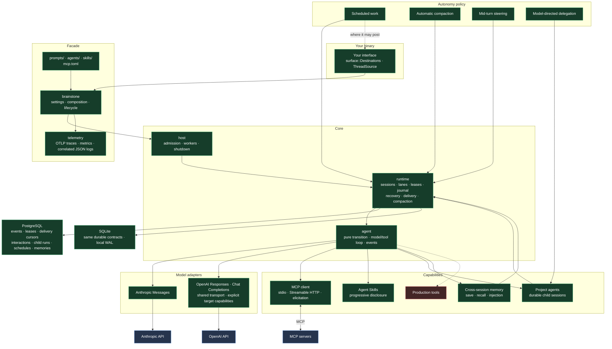

# Architecture

[Back to the README](../README.md)

Green nodes have local, SQLite, or PostgreSQL contract tests. Red nodes are
not implemented. Blue nodes are external services.

## Crates

| Crate | Responsibility |
| --- | --- |
| [agent](../crates/agent) | Model/tool loop and extension interfaces |
| [runtime](../crates/runtime) | Durable operations, shared record codecs, and PostgreSQL/SQLite storage |
| [host](../crates/host) | Prompt admission, workers, and shutdown |
| [telemetry](../crates/telemetry) | Safe correlated logs, portable OTLP traces/metrics, exporter workers and shutdown |
| [brainstone](../crates/brainstone) | The composition root: settings, engine build, and re-exports of every crate below |
| [media](../crates/media) | Validates, bounds, and fits model images from surfaces and MCP; gives images and files stable reply references; provides `CreateFile` for reply attachments |
| [surface](../crates/surface) | Thread attachments, caps, validation, and rendering; `Destinations` lets schedules post to a surface's conversations |
| [anthropic](../crates/anthropic), [openai](../crates/openai) | Model adapters |
| [sigv4](../crates/sigv4) | AWS SigV4 identity and request signing shared by the Bedrock paths of both adapters |
| [mcp](../crates/mcp), [skills](../crates/skills), [subagents](../crates/subagents), [memory](../crates/memory), [policy](../crates/policy) | Agent capabilities |

## Runtime implementation layout

The runtime keeps public execution and persistence contracts at the crate root.
Backend code lives in `memory_backend/`, `postgres_backend/`,
`sqlite_backend/`, and `durable_backend/`. The last routes `DurableStore`
calls to the selected database. The in-memory backend supports
process-local contracts and tests; it does not provide durability.

Record codecs and validation shared by the database backends remain at the
crate root. Database-specific queries, connection management, and migration
execution stay with their backend. These directories are private. Applications use the runtime's public store
types and traits.

## Rust composition and deployment preset

`Host<S, M>` is the application execution handle. A caller supplies
`Runtime<S>`, a `Model`, and a heterogeneous tool `Registry`. Constructors
start no tasks. The application drives `execute` or `run` and owns the
resources it opened. Runtime configuration owns leases,
compaction, and authorization; host configuration owns workers and polling.
Models, tools, stores, and admission retain separate typed extension contracts.

The `brainstone` facade re-exports these composition types. Its optional
`configured` module owns environment parsing, provider selection, agent-directory
loading, and the preset admission chain. The default Cargo feature retains
that preset for compatibility. Core-only consumers disable default features
and select adapter features independently. Both database backends remain part
of the runtime.

`configured(settings)` omits schedule tools; `build(settings, destinations)`
retains explicit destination policy. The preset's `Engine` owns its MCP clients
and database pool and closes them after host shutdown. Applications using the
generic host close their own resources.

## Observability ownership

`agent::observation` uses `tracing` to describe fixed execution boundaries.
It has no exporter, backend, or durability policy. Runtime, provider,
MCP and surface owners annotate actual outcomes. The `telemetry` crate owns the
OpenTelemetry SDK, OTLP transport, safe JSON formatting, fixed metric dimensions,
bounded workers, and shutdown. The composition root keeps the guard alive
for the process. Provider and MCP adapters use its content-free W3C context
accessor to propagate outbound trace context. No observability state is added to journal records or used by the
execution/recovery state machines. See the [contract](../crates/telemetry/README.md).

## Backend and model selection

The composition root selects one `DurableStore` at startup and passes it
through host admission, memory, MCP, scheduling, and subagents. The core stays
generic over its store traits. Database
adapters own SQL, locking, connection setup, migrations, and transient-error
classification. Shared codecs own the meaning of stored records.

`ProviderModel` scopes replay to a stable target and model. Custom endpoint
identity includes the protocol and an endpoint digest, without recording its
credentials. Responses and Chat Completions share transport policy. Capability
validation precedes I/O, and fallback validates its candidate before sending
history. A model's declared window reaches compaction through the same model
seam. No provider-specific branching enters the agent loop.

## Authorization and operator boundary

Optional tool policy runs before `ToolStarted` at runtime dispatch. It gates
native tools, MCP calls, and subagent effects. PostgreSQL and SQLite own an immutable approval
ledger bound to the durable call and current executor/policy configuration.
Pending approval waits share the normal heartbeat and steering lifecycle;
unsupported stores fail closed only when authorization is required. Operator
recovery calls the existing host with an existing operation ID and retains
normal lease fencing. Read-only metadata and explicit sensitive journal reads
are separate operations.
