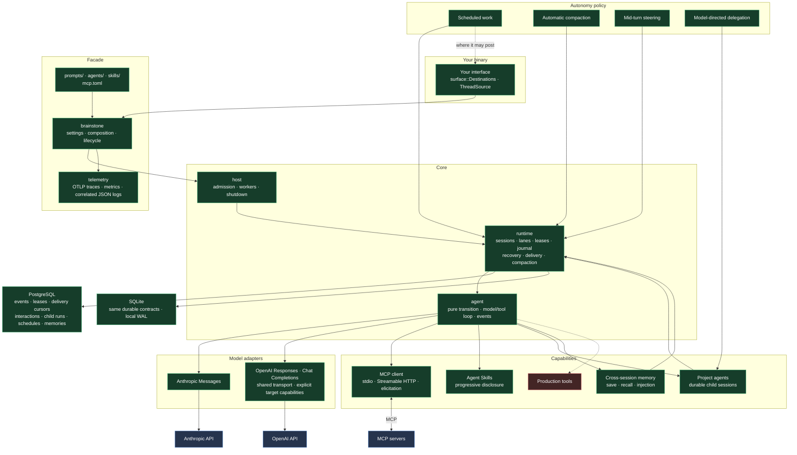

# Architecture

[Back to the README](../README.md)

Green is implemented and covered by local, SQLite, or PostgreSQL contract tests. Red is
not implemented. Blue is an external service.

## Crates

| Crate | Responsibility |
| --- | --- |
| [agent](../crates/agent) | Model/tool loop and extension interfaces |
| [runtime](../crates/runtime) | Durable operations, shared record codecs, and PostgreSQL/SQLite storage |
| [host](../crates/host) | Prompt admission, workers, and shutdown |
| [telemetry](../crates/telemetry) | Safe correlated logs, portable OTLP traces/metrics, exporter workers and shutdown |
| [brainstone](../crates/brainstone) | The composition root: settings, engine build, and re-exports of every crate below |
| [media](../crates/media) | Model-input images (validation, bounds, fitting) shared by surfaces and MCP, the stable reference a reply uses to attach a tool-returned image or file, and `CreateFile`, which lets any agent write a file for the reply |
| [surface](../crates/surface) | Surface-neutral thread input (attachments, caps, validation, rendering) and the `Destinations` seam a surface implements so schedules can post in its conversations |
| [anthropic](../crates/anthropic), [openai](../crates/openai) | Model adapters |
| [sigv4](../crates/sigv4) | AWS SigV4 identity and request signing shared by the Bedrock paths of both adapters |
| [mcp](../crates/mcp), [skills](../crates/skills), [subagents](../crates/subagents), [memory](../crates/memory), [policy](../crates/policy) | Agent capabilities |

## Observability ownership

The `agent::observation` seam describes finite execution boundaries using
`tracing`; it has no exporter, backend or durability policy. Runtime, provider,
MCP and surface owners annotate actual outcomes. The `telemetry` crate owns the
OpenTelemetry SDK, OTLP transport, safe JSON formatting, fixed metric dimensions,
bounded workers and shutdown. The composition root owns the guard's process lifetime. Provider
and MCP adapters use the crate's content-free W3C context accessor for outbound
propagation. No observability state is added to journal records or used by the
execution/recovery state machines. See the [contract](../crates/telemetry/README.md).

## Backend and model selection

The composition root selects one `DurableStore` at startup and passes it
through host admission, memory, MCP, scheduling, and subagents. The core remains generic over its existing store traits. Database
adapters own SQL, locking, connection setup, migrations, and transient-error
classification. Shared codecs own the meaning of stored records.

`ProviderModel` scopes replay to a stable target and model. Custom endpoint
identity includes the protocol and an endpoint digest, without recording its
credentials. Responses and Chat Completions share transport policy. Capability
validation precedes I/O, and fallback validates its candidate before sending
history. A model's declared window reaches compaction through the same model
seam. No provider-specific branching enters the agent loop.

## Authorization and operator boundary

Optional tool policy lives at runtime dispatch, before `ToolStarted` and before
native/MCP/subagent effects. PostgreSQL and SQLite own an immutable approval
ledger bound to the durable call and current executor/policy configuration.
Pending approval waits share the normal heartbeat and steering lifecycle;
unsupported stores fail closed only when authorization is required. Operator
recovery calls the existing host with an existing operation ID and retains
normal lease fencing. Read-only metadata and explicit sensitive journal reads
are separate operations.
